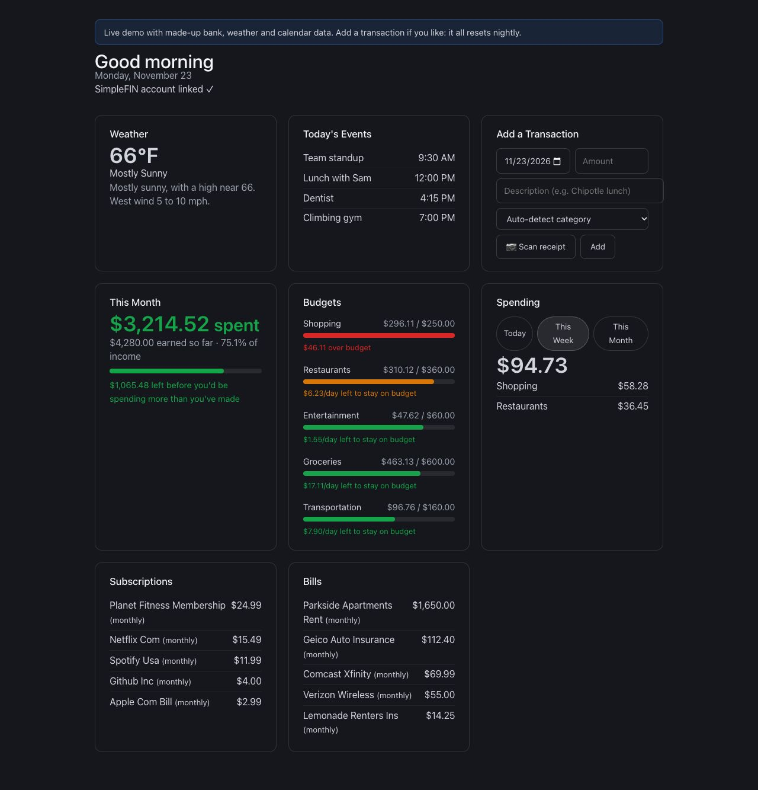
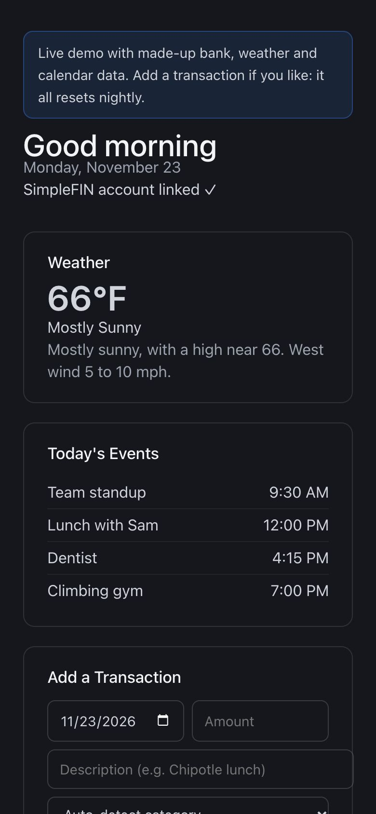

# Daily Dashboard

A personal morning dashboard: spending by category, budgets, recurring bills and subscriptions, weather and today's calendar, refreshed once a day and served instantly from cache.

**[Live demo](https://dashboard-demo.161-153-101-90.sslip.io)** with a made-up bank, weather and calendar. It resets nightly.



## Features

- **Spending** for today, this week and this month, by category. Transfers between your own accounts are left out.
- **Budget vs. income:** month-to-date spending against paycheck deposits.
- **Category budgets** with a "safe to spend per day" figure for the rest of the month.
- **Recurring charges**, detected automatically and split into bills and subscriptions.
- **Manual entries and receipt scanning** (local OCR) so a purchase counts right away; they reconcile automatically once the bank transaction posts (same amount, within 3 days).
- **Weather** from the National Weather Service and **today's events** from Google Calendar.
- Light and dark themes; works on a phone.

## How it works

- **Backend:** Python, FastAPI. **Frontend:** React + Vite, served by the same process.
- **Bank data:** [SimpleFIN Bridge](https://beta-bridge.simplefin.org), chosen over Plaid because Plaid bills per API call while SimpleFIN is a flat ~$15/year. SimpleFIN returns raw descriptions only, so categorizing ([categorizer.py](backend/app/services/categorizer.py)) and recurring-charge detection ([recurring_detector.py](backend/app/services/recurring_detector.py)) are built in.
- **Cached, not live:** a refresh job calls SimpleFIN, NWS and Google Calendar once a day and writes JSON snapshots; the API only reads those, so pages load instantly and API limits are never an issue.
- **Private by default:** the API only answers loopback and Tailscale addresses ([trusted_network.py](backend/app/trusted_network.py)). Reach it through an SSH tunnel or Tailscale; there is no login, so don't expose it publicly.

## Run it with Docker

```bash
git clone https://github.com/jellyman552/daily-dashboard.git
cd daily-dashboard
cp backend/.env.example backend/.env   # timezone, weather location, etc.
docker compose up -d                   # http://127.0.0.1:8420 on that machine
```

Then link your bank: get a setup token from SimpleFIN Bridge and paste it into the "Link SimpleFIN" box. The data refreshes every day at `REFRESH_AT` (05:00 by default). For Google Calendar, run `docker compose exec dashboard python -m scripts.google_authorize` once (see the script for details).

Without Docker: [deploy/systemd/](deploy/systemd/) has units for the API and a daily refresh timer.

## Development

```bash
cd backend
python3 -m venv .venv && source .venv/bin/activate
pip install -r requirements.txt pytest
cp .env.example .env
uvicorn app.main:app --reload --port 8420     # API
cd ../frontend && npm install && npm run dev  # UI, proxies /api to the backend
cd ../backend && pytest -q                    # tests
```

Receipt scanning needs the Tesseract binary: `brew install tesseract` or `apt-get install tesseract-ocr`.

**Demo mode:** `DEMO_MODE=true` swaps the bank for a fictional one ([demo.py](backend/app/services/demo.py)): about five months of made-up transactions that run through the real categorizer, recurring detector and budgets. `python -m scripts.seed_demo` rebuilds it (it refuses to run unless demo mode is on, since it wipes the data folder).

| On a phone |
| --- |
|  |

## License

MIT. See [LICENSE](LICENSE).
